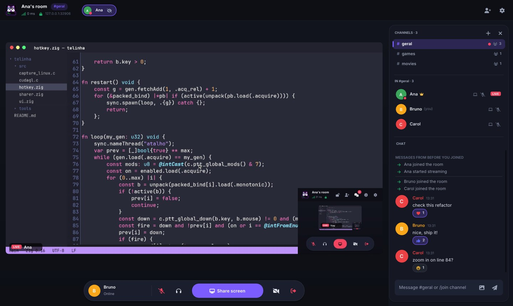
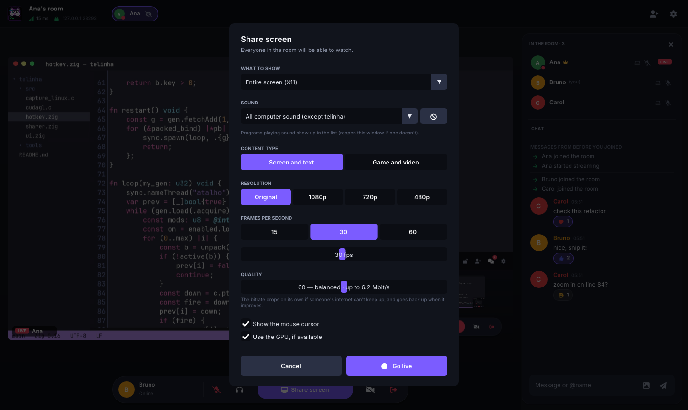
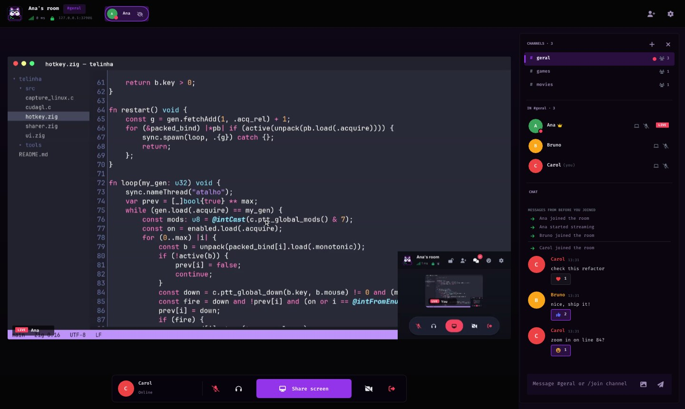
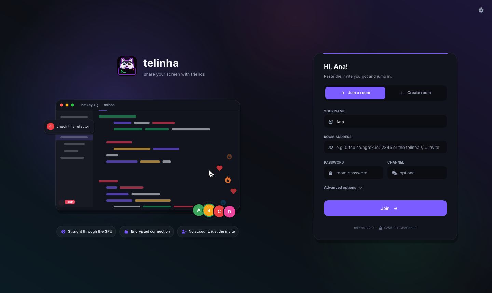
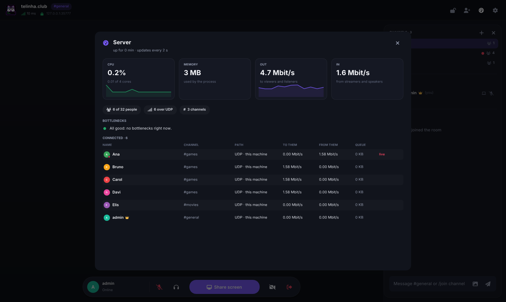
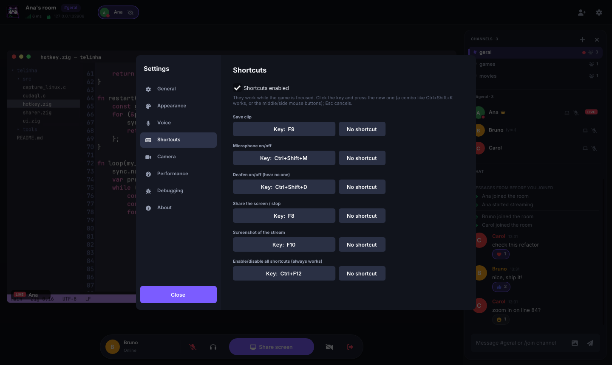
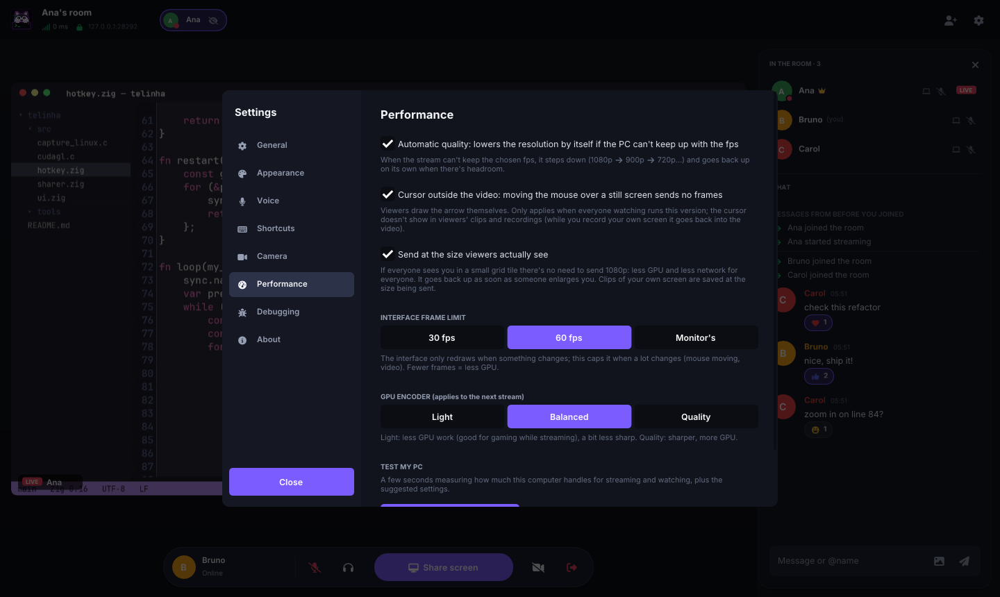

<p align="center">
  
</p>

<h1 align="center">telinha</h1>

<p align="center">
  <strong>Low-latency group screen sharing for Linux and Windows.</strong><br>
  A Discord-style room where anyone can go live and everyone can watch, talk and chat.
</p>

<p align="center">
  
  
  
  
</p>

<p align="center">
  <a href="../../releases/latest"><b>Download</b></a> ·
  <a href="#quick-start">Quick start</a> ·
  <a href="#features">Features</a> ·
  <a href="#performance">Performance</a> ·
  <a href="#building-from-source">Build</a> ·
  <a href="https://rshacudevidro.github.io/telinha/en/"><b>Website &amp; docs</b></a> ·
  <a href="docs/ARCHITECTURE.md">Architecture</a> ·
  <a href="README.pt.md">🇧🇷 Português</a>
</p>

<p align="center">
  
</p>

---

## Why telinha

- **Fast.** Capture, encoding and decoding stay on the GPU when one is available. End-to-end latency is measured on every frame, and the stream adapts before a delay builds up.
- **Zero setup for friends.** A single invite link carries every way into the room: LAN, an opened router port, IPv6 or a built-in public tunnel. Each person joins through the fastest one that works for them.
- **Private.** Every connection is end-to-end encrypted with X25519 and ChaCha20-Poly1305. The room password is part of the key derivation.
- **Light.** The interface only redraws when something changes. Features you don't use cost nothing.
- **Portable.** Windows ships as a single `.exe` with nothing to install. Linux runs on Wayland and X11.

## Download

Grab the latest build from the [Releases page](../../releases/latest).

| Platform | File |
|---|---|
| Windows 10/11 (x86-64) | `telinha-windows-x86_64.exe` |
| Linux (x86-64) | `telinha-linux-x86_64` (run `chmod +x` first) or `telinha-linux-x86_64.tar.gz` |
| Dedicated server | `telinha-server-linux-x86_64` / `telinha-server-linux-aarch64`, or build the Docker image (see [DEPLOY.md](docs/DEPLOY.md)) |
| Debug symbols for crash reports | `telinha-simbolos.tar.gz` |

> [!NOTE]
> The Windows executable is not code-signed, so SmartScreen will warn on first launch. Choose **More info → Run anyway**.

### Install on Linux

One command, no `sudo`. It downloads the latest release, checks its SHA256, puts `telinha` in `~/.local/bin`, adds it to your app menu with its icon and makes `telinha://` invite links open in telinha:

```sh
curl -fsSL https://raw.githubusercontent.com/RshaCuDeVidro/telinha/main/install.sh | sh
```

Run it again to update. To uninstall, use `sh install.sh --remove`. If a system library is missing, the installer tells you the command for your distro.

On Linux, the binary runs on any distro with glibc 2.31 or newer, such as Ubuntu or Pop!_OS 20.04+, Debian 11+, Fedora and Arch. It uses a few system libraries that some distros don't install by default:

```sh
# Debian / Ubuntu / Pop!_OS / Mint
sudo apt install libportal1 libpipewire-0.3-0
# Arch
sudo pacman -S libportal pipewire
# Fedora
sudo dnf install libportal pipewire-libs
```

## Quick start

1. **Create a room.** Open telinha and pick **Create room**. The default port is 7777 and the password is optional.
2. **Invite friends from outside your network.** In the *Inviting people from outside* card, click **Open port on router** for a direct, lowest-latency connection. If your ISP uses CGNAT, click **Create public link** instead. Then **Copy invite** and send it. No luck? The [connection guide](docs/CONNECTING.md) has every other way (manual port forwarding, IPv6, gaming VPNs, SSH tunnels), none needing an API key.
3. **Join.** Paste the `telinha://…` invite on the home screen. telinha pre-fills it if it's already on your clipboard.
4. **Go live.** Click **Share screen**, choose resolution, frame rate, quality and content type, then **Go live**. Everything can be changed mid-stream.
5. **Watch.** Click anyone who is live. Press **F11** for fullscreen, **double-click** for theater mode and **Esc** to leave.
6. **Talk.** Toggle the microphone with **Ctrl+M** and deafen with **Ctrl+D**. Right-click a member to change their voice volume.
7. **Hop between channels.** A server can hold several rooms at once, IRC-style. Click a channel in the panel, press **+** to create one, or type `/join name` in the chat. Your stream comes along.

On Wayland, the system asks which screen or window to share the first time and remembers your choice.

## Features

<table>
<tr>
<td width="50%" valign="top">

### 🖥️ Streaming
- Several people live at once, in a grid that keeps every video as large as possible.
- Spotlight, fullscreen, theater mode and a floating **picture-in-picture** window.
- Share a full screen, a single window, or a rectangle you drag over your own preview.
- Webcam alongside or instead of the screen.
- **Computer audio** from everything, everything except chosen apps, or a single app. telinha never captures its own sound, so there is no echo.

</td>
<td width="50%" valign="top">

### 👀 Watching
- **Zoom** with the mouse wheel, drag to pan, or follow the streamer's cursor, with a minimap.
- A **"look here" pointer** and **drawing on the stream** in 15 colors and 4 widths (highlighter included), visible to everyone watching. Hide other people's drawings if you want; admins can take someone's pen away.
- **Clips** of the last 5 s to 10 min with one click or a global hotkey.
- **MP4 recording** without re-encoding, including audio. Recordings survive resolution changes.
- PNG screenshots at the stream's native resolution.
- **Watch from a browser**: a dedicated server with `--web` serves a page that plays the stream (video, sound and voice) with nothing to install. The server only relays the same frames, so the streamer pays nothing extra; with `--web-tunel` it gets an HTTPS link through a Cloudflare quick tunnel, no account.

</td>
</tr>
<tr>
<td valign="top">

### 🎙️ Voice and chat
- Acoustic echo cancellation, so speakers work as well as headphones.
- RNNoise noise suppression for fans, keyboards and hiss.
- Voice activation or **push-to-talk** that works while a game is focused.
- Opus with FEC, sent ahead of video so it never waits behind a frame.
- Chat with images, reactions, @mentions, history for late joiners, and Markdown: code blocks with a copy button, `inline code`, **bold**, *italic* and clickable links (Shift+Enter for a new line). Color emoji, and right-click a message to copy or reply.
- **Replies that quote** the original message and **private messages** (`/msg name text`), visible only to the two of you.
- **Files in the room**, up to 256 MB: attach, drag onto the window or `/arquivo`. Uploaded once to the server (encrypted on disk, gone after 2 h) and each person downloads it when they click, in the background so video and voice don't suffer.
- Desktop notifications while telinha is in the background.

</td>
<td valign="top">

### 🛡️ Rooms and control
- **Channels, IRC-style**: one server, many rooms. Each channel has its own chat; the **call** (voice and streams) is separate, so you can read one channel while staying in another's call. Channels can have a password, a lock and a topic; pinned ones survive restarts.
- **Verified server identity**: invites carry the server's fingerprint and the app checks it before sending anything, so nobody in the middle can pose as the server.
- The room creator gets the crown and can kick, ban, mute, stop a stream, give or remove admin and lock the room.
- **Server stats for the admin**: CPU, memory, bandwidth in and out, who is lagging and a plain-language guess at the bottleneck.
- **Automatic reconnection** that resumes your stream and the streams you were watching.
- **Updates itself** on Windows and Linux: shows what changes, checks the release signature and swaps the executable. The version history is in Settings → About.
- Live stats: resolution, frame rate, bandwidth and measured end-to-end latency.
- **Bots**: a [Python SDK](docs/BOTS.md) for making your own (commands, events, music in the call, files) and two ready-made ones: the [music bot](docs/BOTS_MUSIC.md) and the [big-screen bot](docs/BOTS_SCREEN.md), which plays videos on its screen with the panel underneath. They show up with a BOT tag and never become admin.
- **Configurable global hotkeys** for clip, mic, deafen, share, screenshot and a master toggle.
- Themes: dark, light, pwnd neon, pwnd light, Nord, Dracula, or your own CSS.

</td>
</tr>
</table>

### ⚡ Under the hood

| | |
|---|---|
| **Codecs** | H.264, plus HEVC on NVIDIA when every viewer can decode it, for less bandwidth at the same quality. AV1 as an experimental option (NVENC on RTX 40 and newer). |
| **GPU encode and decode** | NVIDIA NVENC/NVDEC everywhere. Intel and AMD through Media Foundation on Windows and VA-API on Linux. Otherwise openh264 with SIMD across threads. |
| **Zero-copy pipeline** | On Linux, the compositor's DMA-BUF goes straight to the encoder, through CUDA on NVIDIA and through VA-API VPP on Intel/AMD. On Windows, DXGI textures go through a CUDA kernel into NVENC. Viewers decode with NVDEC straight into an OpenGL texture. Any failure falls back to the CPU path. |
| **Cursor outside the video** | Viewers draw the arrow themselves, so moving the mouse over a still screen sends no frames at all. |
| **Sized for the viewer** | If everyone watches you in a small grid tile, telinha sends a smaller stream and scales back up the moment someone enlarges it. |
| **Transport** | Video, audio and voice over UDP, with only lost fragments resent. Control traffic over TCP. Everything falls back to TCP when UDP is blocked. |
| **Congestion control** | Every frame is acknowledged, so real latency is measured even inside tunnels that hide congestion. A slow viewer drops to half the frames without affecting anyone else. |
| **Native capture** | PipeWire and xdg-desktop-portal on Wayland (Hyprland, GNOME, KDE, Sway), X11, DXGI Desktop Duplication and Windows.Graphics.Capture. |
| **Diagnostics** | One-click debug log and crash reports, with debug symbols published per release so a stack trace can be translated back to source lines. |

## Screenshots

| | |
|---|---|
|  |  |
| **Going live.** Pick what to show, which audio to send, the content type, resolution, frame rate and quality. | **Themes.** The pwnd neon theme, one of six built-ins. You can also bring your own CSS. |
|  |  |
| **Home screen.** Join or create a room, optionally straight into a channel. | **Server stats.** What the admin sees: CPU, memory, bandwidth, people per channel and the likely bottleneck. |
|  |  |
| **Global hotkeys.** Any key, combination or mouse button, active while a game is focused. | **Performance.** Automatic quality, cursor outside the video, viewer-sized streams and a built-in PC test. |

## Performance

Measured on an **Intel i5-2400S** from 2011 (4 cores) with a **GTX 1050 Ti**, at 1080p, using `zig build bench`.

| Content and encoder | Color conversion | Encode | Decode | Bandwidth at 30 fps |
|---|---|---|---|---|
| Scrolling text, openh264 | 3.7 ms | 23 ms | 4 ms | ~200 KB/s |
| Motion, openh264 | 3.9 ms | 13 ms | 13 ms | ~730 KB/s |
| Scrolling text, **NVENC + NVDEC** | on the GPU | **7.5 ms** | **6 ms** | ~500 KB/s |
| Motion, **NVENC + NVDEC** | on the GPU | **8 ms** | **6 ms** | ~630 KB/s |

With the zero-copy path, a 1080p60 HEVC stream on the same machine costs the streamer about **20% of one core**, and the viewer about 10%. End-to-end latency stays around **17 ms** on a local network. These numbers were measured in a headless Sway session on the same GPU, with the real PipeWire portal.

On a real 1080p code screen, NVENC reaches **57 dB PSNR at 0.36 Mbit/s**, including the full keyframe sent when someone joins. On any modern CPU, openh264 alone handles 1080p60.

## Building from source

You need [Zig 0.16](https://ziglang.org/download/). The C and C++ dependencies are fetched by `zig build`: openh264, Dear ImGui, GLFW, FreeType, NASM, and the NVENC and VA-API headers.

On Linux, install the system libraries for the UI and capture:

```sh
# Arch
sudo pacman -S libportal pipewire libx11 libxext libxfixes wayland libxkbcommon libxrandr libxinerama libxcursor libxi
# Debian / Ubuntu
sudo apt install libgl-dev libportal-dev libpipewire-0.3-dev libx11-dev libxext-dev libxfixes-dev \
  libwayland-dev libxkbcommon-dev libxrandr-dev libxinerama-dev libxcursor-dev libxi-dev
```

Then build:

```sh
zig build                          # Linux app + Windows .exe + dedicated server
zig build run                      # run the app
zig build test                     # unit, server integration and codec tests
zig build bench                    # video pipeline benchmark
zig build loadtest -- 8 40 1       # 8 viewers plus one on a 2 Mbit/s link, for 40 s
zig build server -Dserver-only     # server only, without the app dependencies
```

Binaries land in `zig-out/bin/`. Add `-Dcpu=x86_64_v2` for portable builds that run on x86-64 CPUs from about 2009 on, as CI does.

<details>
<summary><b>Command-line options</b></summary>

> The flags are in Portuguese, matching the codebase.

```
--nome X              your display name
--criar [port]        create a room
--entrar host:port    join a room (also accepts a telinha://… invite)
--senha X             room password
--admin TOKEN         join a dedicated server as admin
--publico             with --criar: open the public link right away
--transmitir          go live as soon as you connect
--assistir            watch everyone who is live
--fps N --qualidade N --modo tela|jogo --software
--estatisticas        always show stats
```

</details>

<details>
<summary><b>Environment variables for troubleshooting</b></summary>

| Variable | Effect |
|---|---|
| `TELINHA_DEBUG=1` | Print the timing of every pipeline stage. Without a terminal, use *Settings → Debugging* instead. |
| `TELINHA_IDIOMA=en\|pt` | Force the interface language. |
| `TELINHA_PASTA_CONFIG`, `TELINHA_PASTA_CLIPES` | Use other config and clips folders for a portable setup. |
| `TELINHA_SEM_GPU_CAPTURA=1` | Disable the zero-copy GPU capture path. |
| `TELINHA_SEM_D3DVP=1` | Windows Intel/AMD: send the image to the encoder through the CPU instead of as a GPU texture. |
| `TELINHA_SEM_CUDAGL=1` | Disable CUDA–OpenGL sharing: NVDEC straight to a texture when watching, and NVIDIA zero-copy capture when streaming. |
| `TELINHA_SEM_SHADER=1` | Do color conversion on the CPU. |
| `TELINHA_SEM_DMABUF=1` | Capture through shared memory instead of DMA-BUF. |
| `TELINHA_CURSOR_EMBUTIDO=1` | Let the compositor draw the cursor into the video (Hyprland). |
| `TELINHA_SEM_VAAPI=1` | Skip the VA-API encoder on Linux. |
| `TELINHA_SEM_NVENC=1` | Skip the NVENC encoder. |
| `TELINHA_SEM_MF=1` | Skip the Media Foundation encoder on Windows. |
| `TELINHA_SEM_WGC=1` | Capture windows with PrintWindow on Windows. |
| `TELINHA_SEM_SOM=1` | Don't play received audio. |

If capture fails or is slow, `zig build captest` reports the method, the pixel format and the real frame rate, and saves a frame.

To turn a crash report's stack trace into source lines, use `tools/simbolos.py` with `telinha-simbolos.tar.gz` from the same release.

</details>

## Documentation

The same docs, with search, live at **[rshacudevidro.github.io/telinha](https://rshacudevidro.github.io/telinha/en/)**.

- [User guide](docs/GUIDE.md): everything the app does, chat commands, shortcuts and settings.
- [Troubleshooting](docs/FAQ.md): the questions that come up most.
- [Bots](docs/BOTS.md): the Python SDK, the music bot, a tutorial and the API reference.
- [Architecture](docs/ARCHITECTURE.md): threads, the video pipeline, bandwidth control and performance decisions.
- [Protocol](docs/PROTOCOL.md): handshake, encryption and every message type.
- [Dedicated server](docs/DEPLOY.md): static binary, Docker and systemd.
- [Connection guide](docs/CONNECTING.md): every way for people outside to join (ports, CGNAT, IPv6, VPNs, tunnels).
- [Contributing](CONTRIBUTING.md) and the [changelog](CHANGELOG.md).

Every doc has a Portuguese version: [README](README.pt.md), [user guide](docs/GUIDE.pt.md), [troubleshooting](docs/FAQ.pt.md), [changelog](CHANGELOG.pt.md), [contributing](CONTRIBUTING.pt.md), [architecture](docs/ARCHITECTURE.pt.md), [protocol](docs/PROTOCOL.pt.md), [dedicated server](docs/DEPLOY.pt.md), [connection guide](docs/CONNECTING.pt.md) and [third-party notices](THIRD_PARTY_NOTICES.pt.md).

## License

MIT. See [LICENSE](LICENSE). Third-party components and their licenses are listed in [THIRD_PARTY_NOTICES.md](THIRD_PARTY_NOTICES.md).
