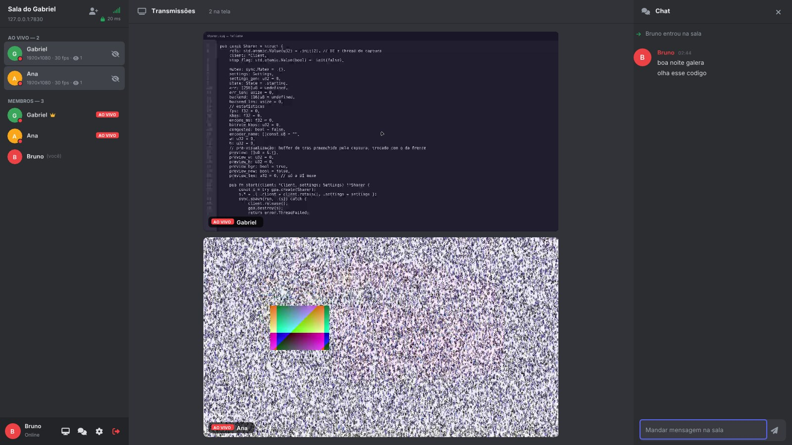
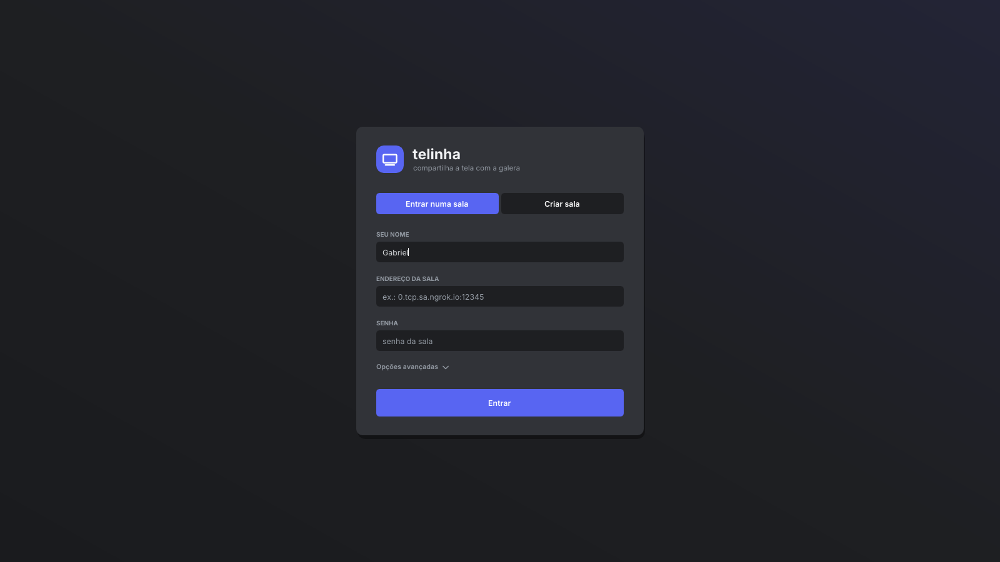
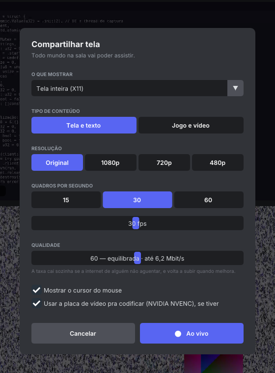

<p align="center">
  
</p>

<h1 align="center">telinha</h1>

<p align="center">
  Compartilhamento de tela em grupo, com cara de Discord, pra Linux e Windows.<br>
  Várias pessoas na mesma sala, qualquer uma transmite, todo mundo assiste — com pouca latência.
</p>

<p align="center">
  
</p>

## O que tem

- **Salas** — alguém cria (ou sobe um [servidor dedicado](docs/DEPLOY.md)), a galera entra com endereço + senha ou com um **convite** `telinha://…`.
- **Várias transmissões ao mesmo tempo**, em grade que se ajusta pra deixar os vídeos o maior possível; destaque, tela cheia e modo cinema.
- **Áudio do computador junto** (vídeo, jogo, música), em Opus com pouca latência, com volume e mudo por transmissão. No Windows o som que o próprio telinha toca não entra na captura, então não tem eco.
- **Chat**, lista de membros, quem está ao vivo, quem está assistindo quem, ping.
- **H.264 com pouca latência**: encode e decode na **placa de vídeo (NVIDIA NVENC/NVDEC)** quando tem, senão **openh264** com SIMD em várias threads. Só manda quadro quando a tela muda; a conversão de cor de quem assiste roda num shader na GPU.
- **Atraso controlado de ponta a ponta, até atrás de túnel**: cada quadro é confirmado, então o telinha mede o atraso real do caminho inteiro — inclusive dentro de ngrok/bore, que escondem o congestionamento. Se o upload não aguenta, a taxa cai e quadros são pulados em vez de acumular atraso; se um espectador não aguenta, ele recomeça de um quadro completo sem travar os outros, e a qualidade só cai pra todo mundo se a maioria estiver sofrendo.
- **Criptografia de ponta a ponta** entre cada pessoa e a sala (X25519 + ChaCha20-Poly1305); a senha da sala entra na derivação das chaves.
- **Reconexão automática**: se a internet oscilar ou o servidor reiniciar, o app volta sozinho, retoma a transmissão e volta a assistir quem estava assistindo.
- **Admin**: quem cria a sala ganha a coroa e pode expulsar gente.
- **Estatísticas ao vivo**: resolução, fps, banda e **atraso de ponta a ponta medido** (captura no transmissor → tela de quem assiste).
- **Captura nativa**: PipeWire + xdg-desktop-portal no Wayland (Hyprland, GNOME, KDE, Sway…), X11, e DXGI Desktop Duplication no Windows. No Hyprland o cursor é desenhado pelo telinha, pra o mouse não ficar com lag enquanto você compartilha.
- **Windows**: um `.exe` só, sem instalar nada.

| | |
|---|---|
|  |  |

## Como usar

1. **Criar sala**: abre o telinha → *Criar sala* (porta padrão 7777, senha opcional).
2. **Galera de fora**: abre um túnel TCP pra porta e cola o endereço no card *Chamando a galera de fora* → *Copiar convite*.
   ```sh
   bore local 7777 --to bore.pub    # grátis, sem conta
   ngrok tcp 7777                   # precisa de conta verificada
   ```
   Na mesma rede (ou Tailscale/ZeroTier/Radmin) é só usar o IP. Tem VPS? Use o [servidor dedicado](docs/DEPLOY.md) e ninguém precisa de túnel.
3. **Entrar**: *Entrar numa sala* → cola o convite (ou endereço + senha).
4. **Transmitir**: botão de tela no canto de baixo da barra lateral → escolhe resolução, fps, qualidade e tipo de conteúdo → *Ao vivo*. Dá pra mudar tudo com a transmissão rolando.
5. **Assistir**: clica em quem está ao vivo. **F11** tela cheia · **duplo clique** modo cinema · **Esc** sai.

No Wayland o sistema pergunta qual tela/janela compartilhar na primeira vez e depois lembra.
No Windows, como o `.exe` não é assinado, o SmartScreen avisa: *Mais informações → Executar assim mesmo*.

## Desempenho

Medido num **Intel i5-2400S (2011, 4 núcleos)** com GTX 1050 Ti, 1080p, via `zig build bench`:

| | conversão de cor | encode | decode | banda (30 fps) |
|---|---|---|---|---|
| texto rolando — openh264 | 3,7 ms | 23 ms | 4 ms | ~200 KB/s |
| movimento — openh264 | 3,9 ms | 13 ms | 13 ms | ~730 KB/s (no teto de 6 Mbit/s) |
| texto rolando — **NVENC + NVDEC** | — (na GPU) | **7 ms** | **6 ms** | ~460 KB/s |
| movimento — **NVENC + NVDEC** | — (na GPU) | **8 ms** | **6 ms** | ~530 KB/s |

Ponta a ponta, numa sala local com conteúdo pesado (tela inteira mudando a cada quadro): **30–50 fps em 1080p com 53–64 ms de atraso** usando NVENC/NVDEC. Em CPU moderna o openh264 sozinho já faz 1080p60.

## Compilar

Precisa do [Zig 0.16](https://ziglang.org/download/). As dependências de C/C++ (openh264, Dear ImGui, GLFW, NASM, headers do NVENC) são baixadas pelo próprio `zig build`.

No Linux, as bibliotecas do sistema pra interface e captura:

```sh
# Arch
sudo pacman -S glfw libportal pipewire libx11 libxext libxfixes
# Debian/Ubuntu
sudo apt install libglfw3-dev libgl-dev libportal-dev libpipewire-0.3-dev libx11-dev libxext-dev libxfixes-dev
```

```sh
zig build                       # app Linux + app Windows (.exe) + servidor dedicado
zig build run                   # roda o app
zig build test                  # testes (unidade + integração do servidor + codec)
zig build bench                 # benchmark do pipeline de vídeo
zig build loadtest -- 8 40 1    # carga: 8 espectadores + 1 em link de 2 Mbit/s, 40 s
zig build loadtest -- 4 40 0 2000  # transmissor atrás de um túnel ruim de 2 Mbit/s
zig build server -Dserver-only  # só o servidor (não baixa as dependências do app)
```

Saída em `zig-out/bin/`: `telinha`, `telinha.exe`, `telinha-server-x86_64`, `telinha-server-aarch64`.
Pra binários que rodam em qualquer CPU x86-64 (como no CI): `zig build -Dcpu=x86_64_v2`.

<details>
<summary>Linha de comando do app</summary>

```
--nome X              seu nome
--criar [porta]       cria uma sala
--entrar host:porta   entra numa sala (aceita convite telinha://…)
--senha X             senha da sala
--admin TOKEN         entra como admin num servidor dedicado
--transmitir          começa a transmitir assim que conectar
--assistir            assiste todo mundo que estiver ao vivo
--fps N --qualidade N --modo tela|jogo --software
--estatisticas        estatísticas sempre visíveis
```
`TELINHA_DEBUG=1` imprime o tempo de cada etapa do pipeline. `TELINHA_SEM_SHADER=1` força a conversão de cor na CPU; `TELINHA_CURSOR_EMBUTIDO=1` deixa o compositor desenhar o cursor (Hyprland); `TELINHA_SEM_SOM=1` não toca o áudio recebido.
</details>

## Documentação

- [Arquitetura](docs/ARCHITECTURE.md) — threads, pipeline, controle de banda, decisões de desempenho
- [Protocolo](docs/PROTOCOL.md) — handshake, criptografia, mensagens
- [Servidor dedicado / deploy](docs/DEPLOY.md) — binário estático, Docker, systemd
- [Contribuindo](CONTRIBUTING.md)

## Licença

MIT — ver [LICENSE](LICENSE). Componentes de terceiros e licenças em [THIRD_PARTY_NOTICES.md](THIRD_PARTY_NOTICES.md).
