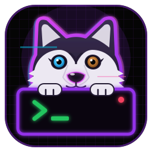
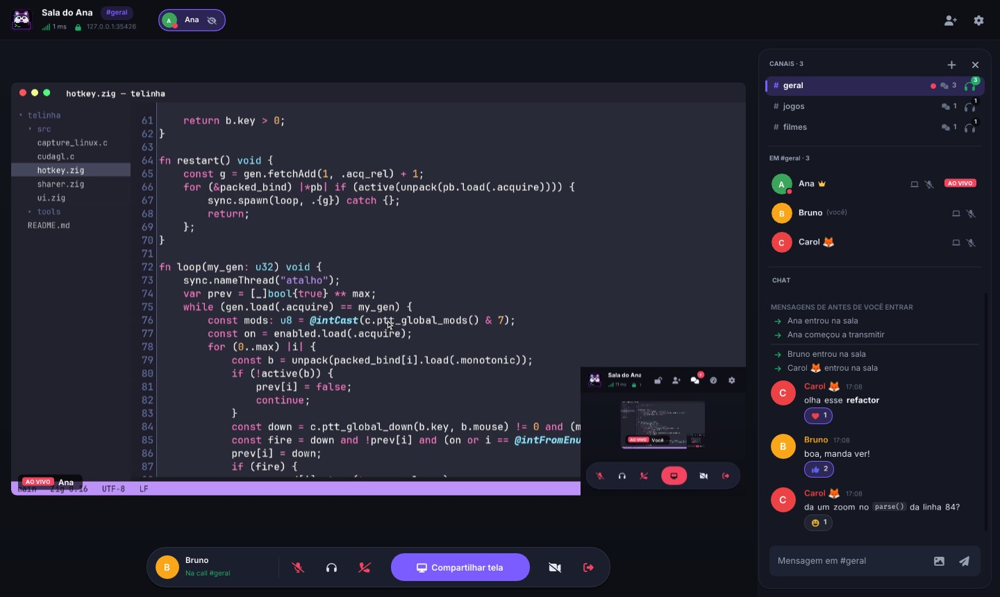
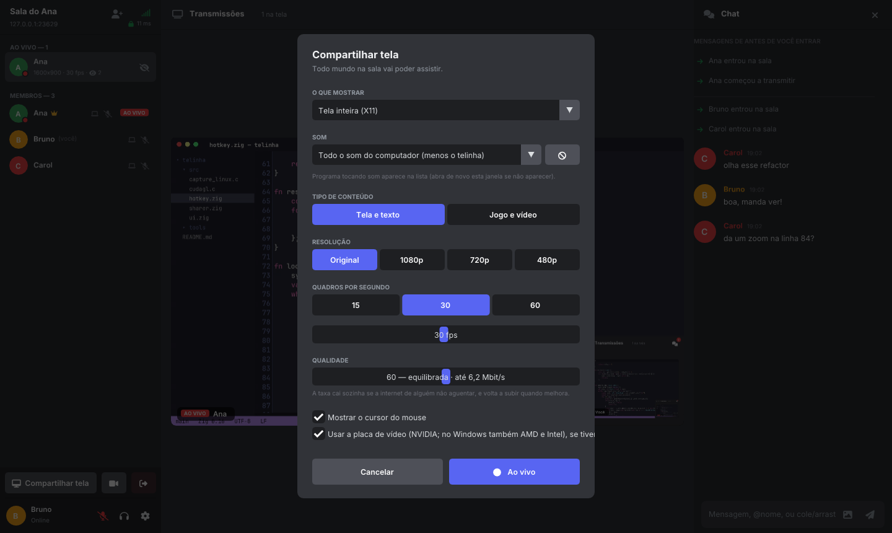
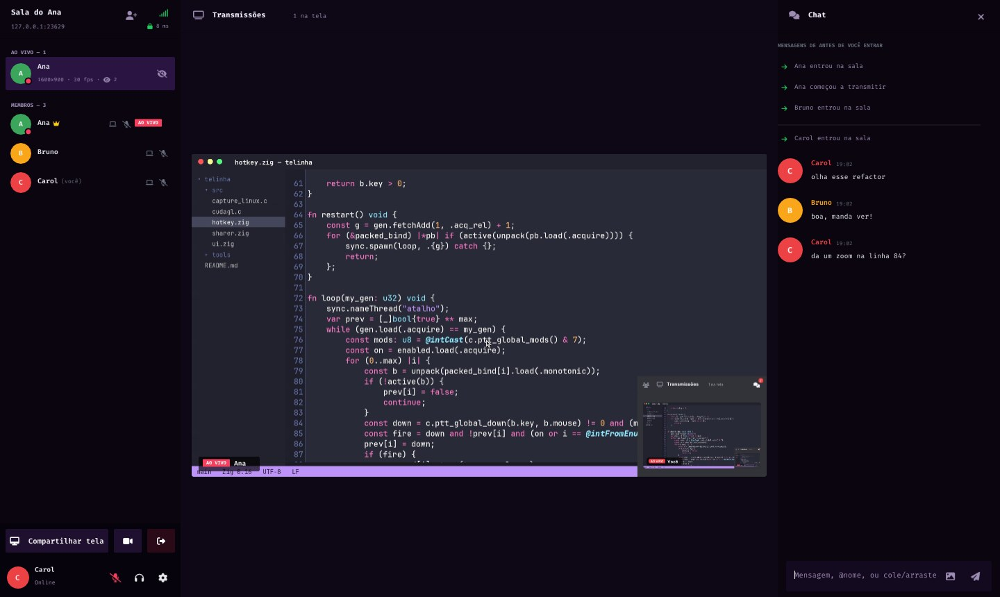
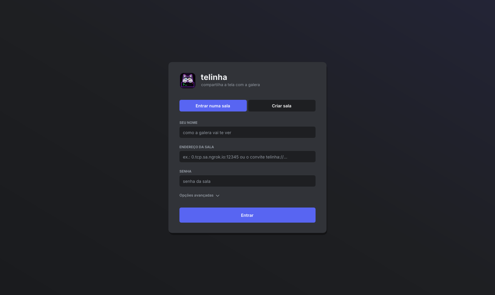
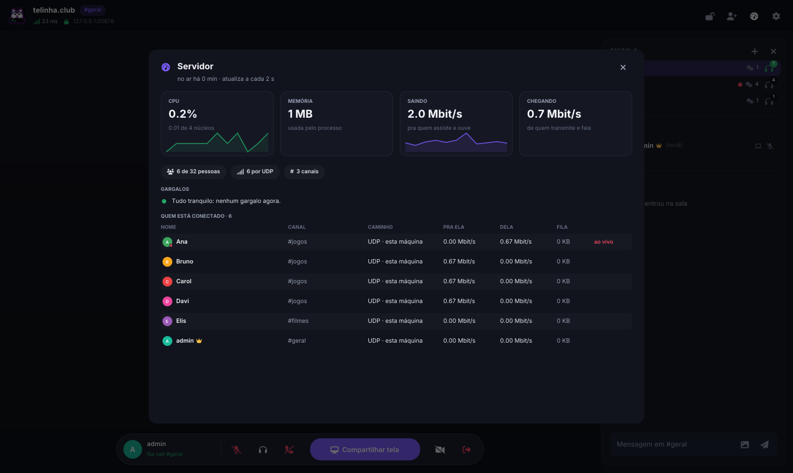
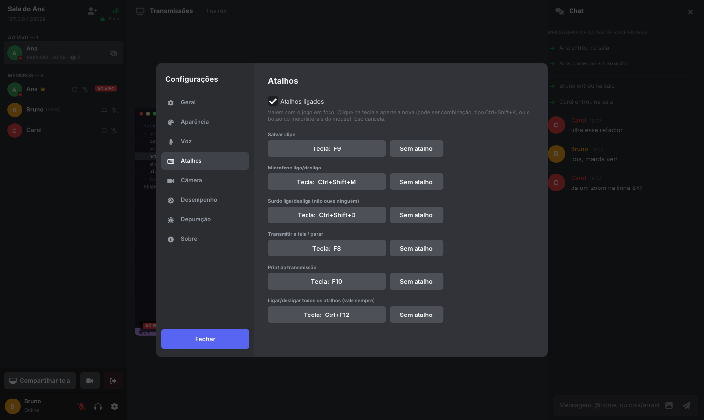
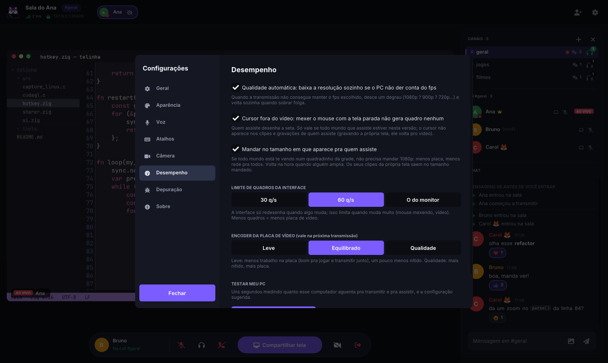

<p align="center">
  
</p>

<h1 align="center">telinha</h1>

<p align="center">
  <strong>Compartilhamento de tela em grupo, com pouca latência, pra Linux e Windows.</strong><br>
  Uma sala com cara de Discord: qualquer um transmite, todo mundo assiste, conversa e manda mensagem.
</p>

<p align="center">
  
  
  
  
</p>

<p align="center">
  <a href="../../releases/latest"><b>Baixar</b></a> ·
  <a href="#começando">Começando</a> ·
  <a href="#o-que-tem">O que tem</a> ·
  <a href="#desempenho">Desempenho</a> ·
  <a href="#compilar">Compilar</a> ·
  <a href="https://rshacudevidro.github.io/telinha/"><b>Site e docs</b></a> ·
  <a href="docs/ARCHITECTURE.pt.md">Arquitetura</a> ·
  <a href="README.md">🇺🇸 English</a>
</p>

<p align="center">
  
</p>

---

## Por que o telinha

- **Rápido.** Captura, codificação e decodificação ficam na placa de vídeo quando tem uma. O atraso de ponta a ponta é medido em todo quadro, e a transmissão se ajusta antes de acumular atraso.
- **Nada pra configurar pra galera.** Um convite só leva todos os caminhos até a sala: rede local, porta aberta no roteador, IPv6 ou o túnel público embutido. Cada pessoa entra pelo mais rápido que funcionar pra ela.
- **Privado.** Toda conexão é cifrada de ponta a ponta com X25519 e ChaCha20-Poly1305. A senha da sala entra na derivação das chaves.
- **Leve.** A interface só redesenha quando algo muda. O que você não usa não custa nada.
- **Portátil.** No Windows é um `.exe` só, sem instalar nada. No Linux roda no Wayland e no X11.

## Baixar

Pegue a versão mais recente na [página de Releases](../../releases/latest).

| Plataforma | Arquivo |
|---|---|
| Windows 10/11 (x86-64) | `telinha-windows-x86_64.exe` |
| Linux (x86-64) | `telinha-linux-x86_64` (rode `chmod +x` antes) ou `telinha-linux-x86_64.tar.gz` |
| Servidor dedicado | `telinha-server-linux-x86_64` / `telinha-server-linux-aarch64`, ou monte a imagem Docker (ver [DEPLOY.md](docs/DEPLOY.pt.md)) |
| Símbolos pros relatórios de travamento | `telinha-simbolos.tar.gz` |

> [!NOTE]
> O `.exe` não é assinado, então o SmartScreen avisa na primeira vez. Clique em **Mais informações → Executar assim mesmo**.

### Instalar no Linux

Um comando, sem `sudo`. Ele baixa a última versão, confere o SHA256, coloca o `telinha` em `~/.local/bin`, cria o atalho no menu de aplicativos com o ícone e faz os convites `telinha://` abrirem no telinha:

```sh
curl -fsSL https://raw.githubusercontent.com/RshaCuDeVidro/telinha/main/install.sh | sh
```

Rode de novo pra atualizar. Pra remover, use `sh install.sh --remove`. Se faltar alguma biblioteca do sistema, o instalador mostra o comando pra sua distro.

No Linux, o binário roda em qualquer distro com glibc 2.31 ou mais nova, como Ubuntu e Pop!_OS 20.04 em diante, Debian 11+, Fedora e Arch. Ele usa algumas bibliotecas do sistema que nem toda distro instala por padrão:

```sh
# Debian / Ubuntu / Pop!_OS / Mint
sudo apt install libportal1 libpipewire-0.3-0
# Arch
sudo pacman -S libportal pipewire
# Fedora
sudo dnf install libportal pipewire-libs
```

## Começando

1. **Crie uma sala.** Abra o telinha e clique em **Criar sala**. A porta padrão é 7777 e a senha é opcional.
2. **Chame a galera de fora.** No card *Chamando a galera de fora*, clique em **Abrir porta no roteador** pra uma conexão direta, com o menor atraso. Se a operadora usa CGNAT, clique em **Criar link público**. Depois é só **Copiar convite** e mandar. Não deu? O [guia de conexão](docs/CONNECTING.pt.md) tem todos os outros jeitos (abrir a porta na mão, IPv6, VPN de jogo, túnel por SSH), nenhum com chave de API.
3. **Entre.** Cole o convite `telinha://…` na tela inicial. Se ele já estiver copiado, o telinha cola sozinho.
4. **Transmita.** Clique em **Compartilhar tela**, escolha resolução, fps, qualidade e tipo de conteúdo, e clique em **Ao vivo**. Dá pra mudar tudo com a transmissão rolando.
5. **Assista.** Clique em quem está ao vivo. **F11** é tela cheia, **duplo clique** é modo cinema e **Esc** sai.
6. **Fale.** **Ctrl+M** liga e desliga o microfone e **Ctrl+D** deixa você surdo. Clique direito em alguém pra mudar o volume da voz dessa pessoa.
7. **Pule entre canais.** Um servidor pode ter várias salas ao mesmo tempo, como no IRC. Clique num canal no painel, aperte **+** pra criar um, ou digite `/join nome` no chat. A sua transmissão vai junto.

No Wayland o sistema pergunta qual tela ou janela compartilhar na primeira vez e depois lembra.

## O que tem

<table>
<tr>
<td width="50%" valign="top">

### 🖥️ Transmitir
- Várias pessoas ao vivo ao mesmo tempo, numa grade que deixa cada vídeo o maior possível.
- Destaque, tela cheia, modo cinema e **janela flutuante** (picture-in-picture).
- Tela inteira, uma janela só, ou um retângulo arrastado em cima da sua própria prévia.
- Câmera junto ou no lugar da tela.
- **Som do computador**: tudo, tudo menos alguns programas, ou só um programa. O som do próprio telinha nunca entra, então não tem eco.

</td>
<td width="50%" valign="top">

### 👀 Assistir
- **Zoom** com a roda do mouse, arrastar pra mover, ou seguir o cursor de quem transmite, com minimapa.
- **Ponteiro "olha aqui"** e **desenhar por cima** em 15 cores e 4 espessuras (com marca-texto), que todo mundo que está vendo enxerga. Dá pra esconder os desenhos dos outros, e o admin pode tirar o pincel de alguém.
- **Clipe** dos últimos 5 s a 10 min num clique ou num atalho global.
- **Gravação em MP4** sem recodificar, com o som. A gravação sobrevive a mudança de resolução.
- Print em PNG na resolução da transmissão.
- **Assistir pelo navegador**: o servidor dedicado com `--web` serve uma página que toca a transmissão (vídeo, som e voz) sem instalar nada. O servidor só repassa os mesmos quadros, então quem transmite não gasta nada a mais; com `--web-tunel` ele ganha um link HTTPS por um túnel rápido da Cloudflare, sem conta.

</td>
</tr>
<tr>
<td valign="top">

### 🎙️ Voz e chat
- Cancelamento de eco, então caixa de som funciona tão bem quanto fone.
- Supressão de ruído com RNNoise: tira ventilador, teclado e chiado.
- Ativação por voz ou **apertar pra falar**, valendo com o jogo em foco.
- Opus com FEC, e a voz fura a fila: nunca espera atrás do vídeo.
- Chat com imagens, reações, @menções, histórico pra quem chega depois e Markdown: blocos de código com botão de copiar, `código`, **negrito**, *itálico* e links clicáveis (Shift+Enter quebra a linha). Emoji colorido, e clique direito copia ou responde uma mensagem.
- **Respostas citando** a mensagem original e **mensagens privadas** (`/msg nome texto`), que só os dois veem.
- **Arquivos na sala**, até 256 MB: anexar, arrastar pra janela ou `/arquivo`. Sobe uma vez pro servidor (cifrado no disco, some depois de 2 h) e cada um baixa quando clicar, em segundo plano, sem atrapalhar vídeo e voz.
- Notificações do sistema com o telinha em segundo plano.

</td>
<td valign="top">

### 🛡️ Salas e controle
- **Canais, como no IRC**: um servidor, várias salas. Cada canal tem o seu chat; a **call** (voz e transmissões) é separada, então dá pra ler um canal e continuar na call de outro. Canal pode ter senha, trava e tópico; os fixos sobrevivem a reiniciar.
- **Identidade do servidor conferida**: o convite leva a impressão do servidor e o app confere antes de mandar qualquer coisa, então ninguém no meio do caminho se passa por ele.
- Quem cria a sala ganha a coroa e pode expulsar, banir, silenciar, parar uma transmissão, dar ou tirar o admin e trancar a sala.
- **Estatísticas do servidor pro admin**: CPU, memória, banda chegando e saindo, quem está atrasando e um palpite em português claro de qual é o gargalo.
- **Reconexão automática**, que retoma a sua transmissão e as que você estava assistindo.
- **Atualiza sozinho** no Windows e no Linux: mostra o que muda, confere a assinatura da release e troca o executável. O histórico de versões fica em Configurações → Sobre.
- Estatísticas ao vivo: resolução, fps, banda e atraso de ponta a ponta medido.
- **Bots**: um [SDK em Python](docs/BOTS.pt.md) pra fazer os seus (comandos, eventos, música na call, arquivos) e um [bot de música](docs/BOTS_MUSIC.pt.md) pronto. Aparecem com a etiqueta BOT e nunca viram admin.
- **Atalhos globais configuráveis** pra clipe, microfone, surdo, transmitir, print e um que liga e desliga todos.
- Temas: escuro, claro, pwnd (neon), pwnd claro, Nord, Drácula, ou o seu próprio CSS.

</td>
</tr>
</table>

### ⚡ Por dentro

| | |
|---|---|
| **Codecs** | H.264, e HEVC na NVIDIA quando todo mundo que assiste consegue decodificar: menos banda pela mesma qualidade. AV1 como opção experimental (NVENC das RTX 40 em diante). |
| **Placa de vídeo** | NVIDIA NVENC/NVDEC em todo lugar. Intel e AMD pelo Media Foundation no Windows e pelo VA-API no Linux. Sem placa, openh264 com SIMD em várias threads. |
| **Sem cópias** | No Linux, o DMA-BUF do compositor vai direto pro encoder, pelo CUDA na NVIDIA e pelo VPP do VA-API na Intel/AMD. No Windows, a textura do DXGI passa por um kernel CUDA até o NVENC. Quem assiste decodifica com o NVDEC direto numa textura OpenGL. Qualquer falha volta pro caminho da CPU. |
| **Cursor fora do vídeo** | Quem assiste desenha a seta. Mexer o mouse com a tela parada não manda nenhum quadro. |
| **No tamanho de quem assiste** | Se todo mundo vê você num quadradinho da grade, o telinha manda menor e volta a subir na hora em que alguém aumenta. |
| **Transporte** | Vídeo, som e voz por UDP, e só o pedaço perdido é reenviado. O controle vai no TCP. Sem UDP, tudo cai pro TCP. |
| **Controle de atraso** | Cada quadro é confirmado, então o atraso real é medido até dentro de túneis que escondem o congestionamento. Um espectador lento passa a receber metade dos quadros sem afetar os outros. |
| **Captura nativa** | PipeWire e xdg-desktop-portal no Wayland (Hyprland, GNOME, KDE, Sway), X11, DXGI Desktop Duplication e Windows.Graphics.Capture. |
| **Diagnóstico** | Log de depuração e relatório de travamento com um clique, e símbolos publicados em cada versão pra traduzir a pilha de volta pra linhas do código. |

## Telas

| | |
|---|---|
|  |  |
| **Ao vivo.** Escolha o que mostrar, qual som mandar, o tipo de conteúdo, a resolução, o fps e a qualidade. | **Temas.** O pwnd neon, um dos seis que vêm prontos. Também dá pra usar o seu próprio CSS. |
|  |  |
| **Tela inicial.** Entra ou cria uma sala, se quiser direto num canal. | **Estatísticas do servidor.** O que o admin vê: CPU, memória, banda, gente por canal e o gargalo provável. |
|  |  |
| **Atalhos globais.** Qualquer tecla, combinação ou botão do mouse, valendo com o jogo em foco. | **Desempenho.** Qualidade automática, cursor fora do vídeo, transmissão no tamanho de quem assiste e o teste do PC. |

## Desempenho

Medido num **Intel i5-2400S** de 2011 (4 núcleos) com uma **GTX 1050 Ti**, em 1080p, com `zig build bench`.

| Conteúdo e encoder | Conversão de cor | Encode | Decode | Banda a 30 fps |
|---|---|---|---|---|
| Texto rolando, openh264 | 3,7 ms | 23 ms | 4 ms | ~200 KB/s |
| Movimento, openh264 | 3,9 ms | 13 ms | 13 ms | ~730 KB/s |
| Texto rolando, **NVENC + NVDEC** | na placa | **7,5 ms** | **6 ms** | ~500 KB/s |
| Movimento, **NVENC + NVDEC** | na placa | **8 ms** | **6 ms** | ~630 KB/s |

Com o caminho sem cópias, uma transmissão 1080p60 em HEVC na mesma máquina custa uns **20% de um núcleo** pra quem transmite, e uns 10% pra quem assiste. O atraso de ponta a ponta fica perto de **17 ms** na rede local. Medido numa sessão Sway sem tela na mesma placa, com o portal do PipeWire de verdade.

Numa tela de código de verdade em 1080p, o NVENC chega a **57 dB de PSNR com 0,36 Mbit/s**, inclusive no quadro completo que sai quando alguém entra. Em qualquer CPU moderna, o openh264 sozinho faz 1080p60.

## Compilar

Precisa do [Zig 0.16](https://ziglang.org/download/). As dependências de C e C++ são baixadas pelo próprio `zig build`: openh264, Dear ImGui, GLFW, FreeType, NASM e os headers do NVENC e do VA-API.

No Linux, instale as bibliotecas do sistema pra interface e pra captura:

```sh
# Arch
sudo pacman -S libportal pipewire libx11 libxext libxfixes wayland libxkbcommon libxrandr libxinerama libxcursor libxi
# Debian / Ubuntu
sudo apt install libgl-dev libportal-dev libpipewire-0.3-dev libx11-dev libxext-dev libxfixes-dev \
  libwayland-dev libxkbcommon-dev libxrandr-dev libxinerama-dev libxcursor-dev libxi-dev
```

E compile:

```sh
zig build                          # app Linux + .exe do Windows + servidor dedicado
zig build run                      # roda o app
zig build test                     # testes de unidade, integração do servidor e codec
zig build bench                    # benchmark do pipeline de vídeo
zig build loadtest -- 8 40 1       # 8 espectadores e mais um num link de 2 Mbit/s, por 40 s
zig build server -Dserver-only     # só o servidor, sem as dependências do app
```

Os binários saem em `zig-out/bin/`. Com `-Dcpu=x86_64_v2` eles rodam em CPUs x86-64 de 2009 pra cá, como no CI.

<details>
<summary><b>Linha de comando</b></summary>

```
--nome X              seu nome
--criar [porta]       cria uma sala
--entrar host:porta   entra numa sala (aceita convite telinha://…)
--senha X             senha da sala
--admin TOKEN         entra como admin num servidor dedicado
--publico             com --criar: já abre o link público
--transmitir          começa a transmitir assim que conectar
--assistir            assiste todo mundo que estiver ao vivo
--fps N --qualidade N --modo tela|jogo --software
--estatisticas        estatísticas sempre visíveis
```

</details>

<details>
<summary><b>Variáveis de ambiente pra investigar problemas</b></summary>

| Variável | Efeito |
|---|---|
| `TELINHA_DEBUG=1` | Imprime o tempo de cada etapa do pipeline. Sem terminal, use *Configurações → Depuração*. |
| `TELINHA_IDIOMA=en\|pt` | Força o idioma da interface. |
| `TELINHA_PASTA_CONFIG`, `TELINHA_PASTA_CLIPES` | Trocam as pastas de configuração e de clipes (telinha portátil). |
| `TELINHA_SEM_GPU_CAPTURA=1` | Desliga a captura sem cópias pela placa. |
| `TELINHA_SEM_D3DVP=1` | Windows Intel/AMD: manda a imagem pro encoder pela CPU em vez de textura na placa. |
| `TELINHA_SEM_CUDAGL=1` | Desliga a ponte CUDA–OpenGL: o NVDEC direto na textura pra quem assiste e a captura sem cópias na NVIDIA pra quem transmite. |
| `TELINHA_SEM_SHADER=1` | Faz a conversão de cor na CPU. |
| `TELINHA_SEM_DMABUF=1` | Captura por memória compartilhada em vez de DMA-BUF. |
| `TELINHA_CURSOR_EMBUTIDO=1` | Deixa o compositor desenhar o cursor no vídeo (Hyprland). |
| `TELINHA_SEM_VAAPI=1` | Pula o encoder VA-API no Linux. |
| `TELINHA_SEM_NVENC=1` | Pula o encoder NVENC. |
| `TELINHA_SEM_MF=1` | Pula o encoder do Media Foundation no Windows. |
| `TELINHA_SEM_WGC=1` | Captura janela por PrintWindow no Windows. |
| `TELINHA_SEM_SOM=1` | Não toca o áudio recebido. |

Se a captura não funcionar ou estiver lenta, `zig build captest` mostra o método, o formato e o fps real, e salva um quadro.

Pra traduzir a pilha de um relatório de travamento em linhas do código, use `tools/simbolos.py` com o `telinha-simbolos.tar.gz` da mesma versão.

</details>

## Documentação

Os mesmos docs, com busca, ficam em **[rshacudevidro.github.io/telinha](https://rshacudevidro.github.io/telinha/)**.

- [Guia de uso](docs/GUIDE.pt.md): tudo o que o app faz, comandos do chat, atalhos e configurações.
- [Problemas comuns](docs/FAQ.pt.md): as dúvidas que mais aparecem.
- [Bots](docs/BOTS.pt.md): o SDK em Python, o bot de música, um tutorial e a referência da API.
- [Arquitetura](docs/ARCHITECTURE.pt.md): threads, pipeline de vídeo, controle de banda e decisões de desempenho.
- [Protocolo](docs/PROTOCOL.pt.md): handshake, criptografia e cada tipo de mensagem.
- [Servidor dedicado](docs/DEPLOY.pt.md): binário estático, Docker e systemd.
- [Guia de conexão](docs/CONNECTING.pt.md): todos os jeitos de a galera de fora entrar (porta, CGNAT, IPv6, VPN, túneis).
- [Contribuindo](CONTRIBUTING.pt.md) e o [changelog](CHANGELOG.pt.md).

## Licença

MIT. Ver [LICENSE](LICENSE). Componentes de terceiros e suas licenças estão em [THIRD_PARTY_NOTICES.pt.md](THIRD_PARTY_NOTICES.pt.md).
